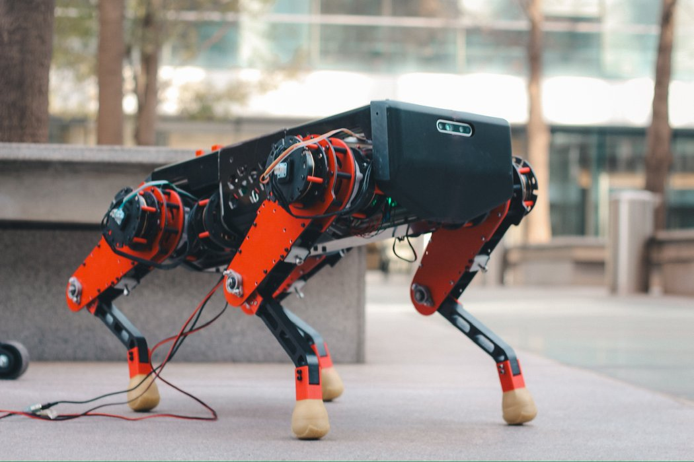
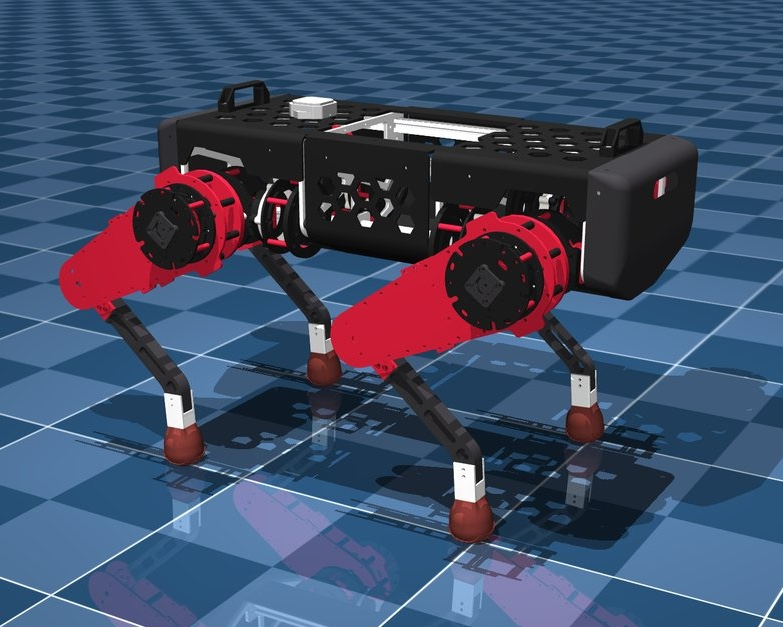

# KILTRO

Robot description of KILTRO, a 25.4 kg quadruped, in two formats: a URDF and the
MuJoCo (MJCF) model we use for MPC and open-loop gait tests. The robot is built; the
URDF was derived from the MJCF. Both share the same kinematics, masses, inertias, joint
limits and collision shapes, and only differ in how the visual meshes are packaged
(see Visual meshes). The joint table and conventions below apply to both.

<p align="center">
  
  
</p>
<p align="center"><i>Left: the real robot. Right: the MJCF model in MuJoCo.</i></p>

```
urdf/kiltro.urdf      13 links, 12 revolute joints, plus 4 fixed foot frames
meshes/               47 visual OBJ meshes, metres
view_in_mujoco.py     loads the URDF in MuJoCo to look at it
mjcf/                 the same robot as a MuJoCo model: kiltro.xml, scene.xml, assets/
images/               photos of the robot and the model
```

## Conventions

Metres, kilograms, radians. Trunk frame is X forward, Y left, Z up.

Joint zero is the mid-stance pose with the legs folded, not the straight-leg pose. At
zero the hip sits 374 mm above the foot centre; fully extended the leg reaches 544 mm. The
offsets live in the link origins, so a simulator reading the URDF gets this for free, but
it is worth knowing if you compare against your own kinematics.

## Joints

| Joint | Axis | Limits (rad) | Limits (deg) | Effort (Nm) | Velocity (rad/s) |
|---|---|---|---|---|---|
| `FR_hip_joint`, `RR_hip_joint` | X | -0.25 to 0.5 | -14.3 to 28.6 | 31.74 | 5.745 |
| `FL_hip_joint`, `RL_hip_joint` | X | -0.5 to 0.25 | -28.6 to 14.3 | 31.74 | 5.745 |
| `*_thigh_joint` | Y | -2.6 to 0.825 | -149.0 to 47.3 | 31.74 | 5.745 |
| `*_calf_joint` | Y | -0.425 to 0.525 | -24.4 to 30.1 | 38.09 | 4.788 |

The abduction axis is X on all four legs, but the left legs are mirrored about the XZ
plane, so the same sign swings them the other way: on the right legs a positive angle
moves the leg inward, on the left legs outward. The travel is asymmetric because the
trunk sets the physical stop, hence the mirrored limits. 

Velocity limits are 150 rad/s at the motor divided by the gear ratio.

## Actuation

Brushless motors, at 24 V.

Abduction and thigh run a two-stage 1:5.11 planetary, 1:26.11 overall. The knee adds a
30/36 tooth belt on top, 1:31.33 overall.

## Collision geometry

Boxes, cylinders and spheres, not the meshes.
The foot is a sphere of 31.25 mm radius.

## Visual meshes

The URDF and the MJCF show the same geometry with different mesh files. URDF gives each
visual a single flat colour, so the CAD is exported split by material: 47 OBJ files, one
colour each. The MJCF uses one multicolour mesh per part, 7 in total. Every triangle
carries a texture coordinate pointing to a stripe in `mjcf/assets/palette.png`, one stripe
per CAD material, using fewer meshes in this case.

## Observation

We use reflected rotor inertia, 0.03 kg m2 per joint, as the `armature` attribute on MuJoCo.

## Testing

For testing the URDF on MuJoCo we use view_in_mujoco.py

```
python view_in_mujoco.py          # static pose, pinned base, joint sliders
python view_in_mujoco.py --drop   # free base with gravity
python view_in_mujoco.py --check  # masses, inertias and limits, no window
```

The default mode pins the base and turns gravity off so the sliders are usable.

The MJCF model opens directly in the MuJoCo viewer:

```
python -m mujoco.viewer --mjcf="$PWD/mjcf/scene.xml"
```